# Các dáng của Clawd

Mỗi trạng thái có 3 kiểu, pet chọn ngẫu nhiên một kiểu khi đổi trạng thái. Bấm vào pet trên app desktop để đổi sang kiểu khác của trạng thái đang hiện.

Hình vẽ lấy từ [clawd-crew](https://github.com/hudcolighting/clawd-crew) (GPL-3.0).

| Trạng thái · khi nào hiện | Kiểu 1 | Kiểu 2 | Kiểu 3 |
|---|:-:|:-:|:-:|
| **idle** Rảnh, chờ chú gõ |  Classic |  Coffee |  Humming |
| **sleeping** Rảnh lâu hơn 10 phút |  Classic |  Tucked in |  Dozing |
| **thinking** Claude đang nghĩ |  Classic |  Pacing |  Cube |
| **responding** Claude đang viết câu trả lời |  Classic |  Letter |  Board |
| **typing** Sửa / ghi file (Edit, Write) |  Classic |  Matrix |  Desk |
| **reading** Đọc file (Read) |  Classic |  Paper |  Tablet |
| **searching** Tìm file, tìm chữ (Grep, Glob) |  Classic |  Torch |  Binocs |
| **running** Chạy lệnh (Bash) |  Classic |  Treadmill |  Progress |
| **browsing** Lên web (WebFetch, WebSearch, browser) |  Classic |  Surfing |  Browser |
| **delegating** Giao việc cho subagent (Agent) |  Classic |  Hand-off |  Tower |
| **rallying** Chạy workflow |  Classic |  Line |  Horde |
| **planning** Lập plan, task list |  Classic |  Map |  Stickies |
| **tooling** Tool khác, MCP |  Classic |  Hammer |  Toolbox |
| **waiting** Cần chú: xin quyền, hỏi, duyệt plan |  Classic |  Sign |  Bell |
| **done** Xong lượt; test qua; bấm vào pet |  Classic |  Trophy |  Dance |
| **error** Lệnh lỗi; test fail |  Classic |  Smoke |  Rain |
| **compacting** Đang /compact |  Classic |  Squeeze |  Vacuum |

<!-- Sinh tự động từ hooks/crew-sprites.js, đừng sửa tay. -->
